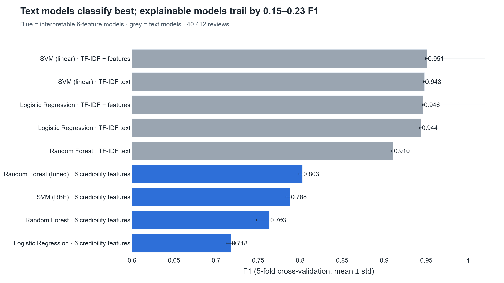
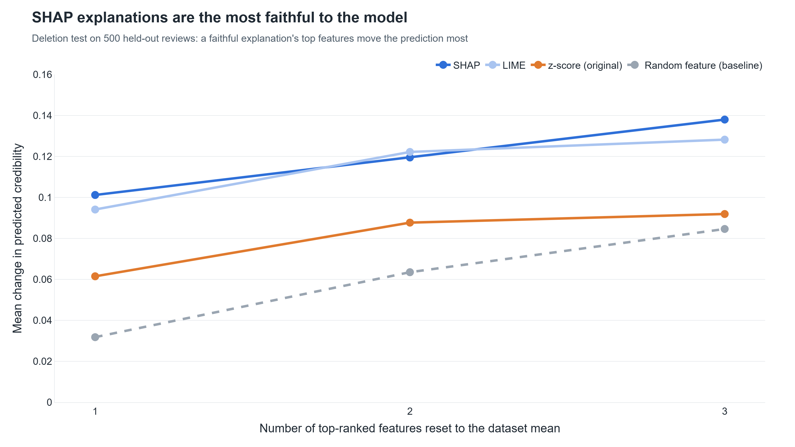

# Explainable Consumer Review Intelligence System

Scores how credible each consumer review is, explains **why** in plain English, and uses that
score to build product summaries that fake reviews can't dominate.

**Reviews → Preprocessing → Feature Extraction → Credibility Assessment → Explainability →
Credibility-Aware Summarization → Dashboard**

**What's new:** the credibility model decides how much each review counts in the summary, and
every summary sentence can be traced back to its review, its score and the SHAP explanation of
that score. On 40,412 labelled Amazon reviews this cuts the share of summary sentences taken from
fake reviews from **92% to 42%**. Details: [docs/NOVELTY.md](docs/NOVELTY.md).


## Key results

All numbers are on the full dataset (40,412 reviews, 10 categories), from
[docs/RESULTS.md](docs/RESULTS.md), and can be regenerated with one command (see
[Reproducing the results](#reproducing-the-results)).

| | Result |
|---|---|
| Fake content in 5-sentence summaries | **92% → 42%** (standard → credibility-aware); 97% → 43% at 3 sentences, 91% → 36% at 8 |
| ROUGE-L vs a genuine-only summary | **0.314 → 0.405** (ROUGE-2 0.160 → 0.306) |
| Best classifier (5-fold CV F1) | **0.951**, linear SVM on TF-IDF + credibility features |
| Deployed explainable model (5-fold CV F1) | **0.763**, Random Forest on 6 human-readable features |
| Most important feature (ablation) | repetition ratio: F1 drops by 0.192 without it |
| Explanation faithfulness (deletion test) | SHAP 0.101 vs 0.032 for a random feature |

<table>
<tr>
<td></td>
<td></td>
</tr>
<tr>
<td></td>
<td></td>
</tr>
</table>

The deployed model gives up about 0.19 F1 against the best text model in exchange for
explanations a person can follow; adding the six features to a text model does not change its
accuracy significantly (McNemar p = 0.84 / 0.13). All 13 charts, as PNG for slides and SVG for
papers, are in [`docs/figures/paper/`](docs/figures/paper/).

## Run it

Install into a **virtual environment** (`.venv`, ignored by git) so the packages, `python` and
Streamlit all come from the same Python 3.11 or 3.12. Create it once, from the project folder.

**Windows (PowerShell)**

```powershell
py -3.12 -m venv .venv
.venv\Scripts\Activate.ps1
python -m pip install --upgrade pip
python -m pip install -r requirements.txt -r requirements-dev.txt
python -m streamlit run app.py
```

In Git Bash or cmd, activate with `source .venv/Scripts/activate` or `.venv\Scripts\activate.bat`
instead. If PowerShell refuses to run the activate script, run
`Set-ExecutionPolicy -Scope CurrentUser RemoteSigned` once.

**Linux / macOS**

```bash
python3.12 -m venv .venv          # or python3 -m venv .venv
source .venv/bin/activate
python -m pip install --upgrade pip
python -m pip install -r requirements.txt -r requirements-dev.txt
python -m streamlit run app.py
```

Each new terminal: activate the venv again (`.venv\Scripts\Activate.ps1` or
`source .venv/bin/activate`), then run the app. In VS Code, pick the `.venv` interpreter
(*Python: Select Interpreter*) and its terminals activate it automatically. `deactivate` leaves the venv.

Opens at http://localhost:8501. Choose **Kaggle fake-reviews dataset (≈40k reviews)** on the
Home page (about 12 s to load the first time, then cached). Every page uses the data source
chosen on Home.

| Page | What it shows |
|---|---|
| Home | Overview of the loaded data, credibility distribution, feature importance |
| Novelty | Pipeline, evidence from the experiments, trace a summary sentence back to its reasons |
| Dataset | Class balance, categories, ratings, feature distributions, raw data |
| Model Comparison | 9 classifiers (+ DistilBERT when trained) on the same test set |
| Performance | Metrics, confusion matrix, ROC/PR curves, threshold explorer, CV, significance |
| Explainability | SHAP (global + per review), LIME (features + words), method agreement |
| Summarization | Standard vs credibility-aware summaries side by side, full evaluation |
| Ablation Study | What each feature contributes |
| Experimental Results | All tables and figures, CSV / Markdown / LaTeX downloads, provenance |
| Live Demo | Type any review: score, SHAP reasons, LIME words, effect on the summary |
| Review Explorer | Product summaries, attribute consensus/conflicts, per-review drilldown, storage |


More screenshots with captions: [docs/SYSTEM_OUTPUT.md](docs/SYSTEM_OUTPUT.md).

### Troubleshooting

- **`ModuleNotFoundError` (e.g. `No module named 'shap'`)**: the app is running on a different Python
  than the one you installed into. Activate the venv (see [Run it](#run-it)), then run
  `python -m pip install -r requirements.txt` and start the app with `python -m streamlit run app.py`.
- **Figure export fails** (`write_image`): needs `plotly>=6.1.1` with `kaleido>=1.0`, plus an installed
  Chrome or Edge (or run `kaleido_get_chrome`).
- **Gemini explanation shows "unavailable"**: optional. Put `GEMINI_API_KEY=...` in a `.env` file;
  without it the built-in explanation is used.

## Tests

With the venv activated:

```bash
python -m pytest            # 52 tests
```

## The dataset

The **[Fake Reviews Dataset](https://www.kaggle.com/datasets/mexwell/fake-reviews-dataset)** is
bundled at `data/fake reviews dataset.csv`: 40,432 Amazon reviews (40,412 after removing 20 exact
duplicates) from 10 categories, balanced between `OR` (original, human-written = **genuine**) and
`CG` (computer-generated = **fake**). It was introduced by Salminen et al. (2022), *Journal of
Retailing and Consumer Services* (verify the reference before citing). The bundled
`data/sample_reviews.csv` (15 rows) is for quick checks; you can also upload your own CSV on Home.

Every model and experiment uses one stratified 80/20 split (`src/splits.py`, seed 42), exported to
`results/split_indices.json` so the DistilBERT notebook uses the same rows. In this dataset
`product_id` is the Amazon category, so "product" summaries are category summaries.

## Reproducing the results

The dashboard pages only read `results/`; every number comes from scripts in `experiments/`:

```bash
python experiments/run_all.py                 # every experiment, tables and figures (~17 min)
python experiments/export_paper_figures.py    # the slide/paper charts in docs/figures/paper/
python scripts/capture_screenshots.py         # dashboard screenshots (needs requirements-dev.txt)
```

`run_all.py` writes `results/*.json`, `docs/RESULTS.md`, `results/tables/*.csv|.tex` and
`docs/figures/*.png`. **DistilBERT** needs a GPU: run `notebooks/bert_finetune_colab.ipynb` on
Google Colab, put its `distilbert.csv` and `distilbert_meta.json` in `results/predictions/`, then
re-run `run_all.py`. Its results are not in the tables yet.

## Project structure

| Path | Purpose |
|---|---|
| `app.py`, `pages/` | Streamlit dashboard: Home + one page per feature |
| `src/preprocessing.py`, `src/features.py` | Cleaning; the 6 credibility features |
| `src/credibility_model.py` | Deployed Random Forest, credibility score and High / Medium / Low labels |
| `src/explainability.py`, `src/shap_explainer.py`, `src/lime_explainer.py` | z-score, SHAP and LIME explanations |
| `src/summarizer.py`, `src/summary_eval.py` | Standard, credibility-aware and oracle summaries; their evaluation |
| `src/model_zoo.py`, `src/text_features.py` | Classifiers and feature sets for the model comparison |
| `src/evaluation.py`, `src/performance.py` | Metrics, threshold sweep, per-category metrics, McNemar |
| `src/ablation.py`, `src/explanation_eval.py` | Ablation study; explanation agreement and faithfulness |
| `src/pipeline.py`, `src/splits.py`, `src/results_io.py` | End-to-end pipeline, shared split, results files |
| `src/charts/`, `src/report_figures.py` | Plotly chart builders shared by pages and figure export |
| `src/single_review.py`, `src/novelty.py` | Live Demo scoring; Novelty page helpers |
| `src/comparison.py`, `src/storage.py`, `src/model_management.py`, `src/llm_explainer.py` | Attribute comparison, SQLite storage, model versioning, optional Gemini explanation |
| `experiments/` | Offline experiments writing `results/` |
| `notebooks/bert_finetune_colab.ipynb` | DistilBERT fine-tuning on Colab |
| `tests/` | pytest suite |

## Documentation

| Document | Contents |
|---|---|
| [docs/RESULTS.md](docs/RESULTS.md) | All result tables and key findings (generated) |
| [docs/NOVELTY.md](docs/NOVELTY.md) | Contributions, evidence, related work, limitations |
| [docs/presentation/](docs/presentation/) | Per-feature presentation guides and the live-demo runbook |
| [docs/SYSTEM_OUTPUT.md](docs/SYSTEM_OUTPUT.md) | Dashboard screenshots with captions |
| [docs/README.md](docs/README.md) | Implementation plan: phases, branches, commits per feature |

## Design notes and limitations

- **Explainability over raw accuracy.** The deployed model uses six human-readable signals so every
  score can be explained; text models classify better (see Model Comparison). A stronger model's
  scores could drive the summary weights while SHAP on the six features keeps the explanations.
- **Extractive summaries.** Every summary sentence is a real sentence from a real review, so
  nothing is hallucinated and everything is traceable, at the cost of fluency.
- **Low-credibility reviews are surfaced, not deleted.** They're down-weighted in the summary and
  listed separately; hard deletion was tested and lowers summary quality.
- **Fake = computer-generated.** Human-written deceptive reviews may behave differently.
- **Contamination is reduced, not removed:** 42% of summary sentences still come from fake reviews,
  limited mainly by the deployed model letting 31% of fakes through.
- **Sentiment** uses a small built-in word lexicon; VADER or a transformer sentiment model can replace
  `sentiment_score()` in `src/features.py` without other changes.

## Extending the feature set

Add a function to `src/features.py`, add its name to `FEATURE_COLUMNS` (and `FEATURE_GROUPS`), and
describe it in `FEATURE_MEANING` / `HIGH_IS_CREDIBLE` in `src/explainability.py`. The model, SHAP,
ablation study and dashboard pick it up automatically; re-run `python experiments/run_all.py` to
update the results.
