# System Output — Screenshots

Captured automatically by `python scripts/capture_screenshots.py` (Streamlit + Playwright,
1440 px wide, full Kaggle dataset of 40,412 reviews selected on Home). Re-run the script after
any UI change to refresh them all. Live Demo examples are drawn at random from the held-out
test split, so the reviews differ between runs.

**For the report's "System Output" section, use S2, S3 and S5.** They show the three things the
brief asks for: credibility scores, explanations and generated summaries.

## S1. Home: overview
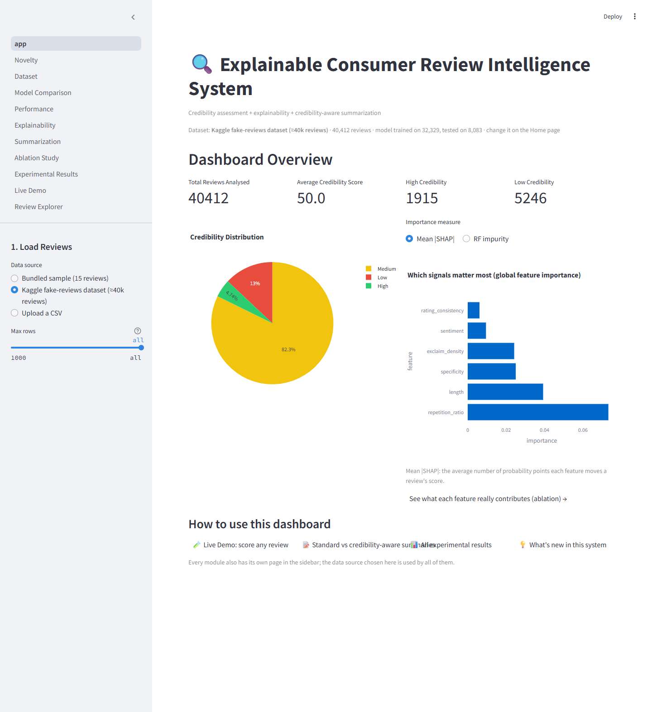
Overview of the full dataset: review count, average credibility, High/Low counts, the credibility
distribution and global feature importance (mean |SHAP| or Random Forest impurity).

## S2. Live Demo: a genuine review
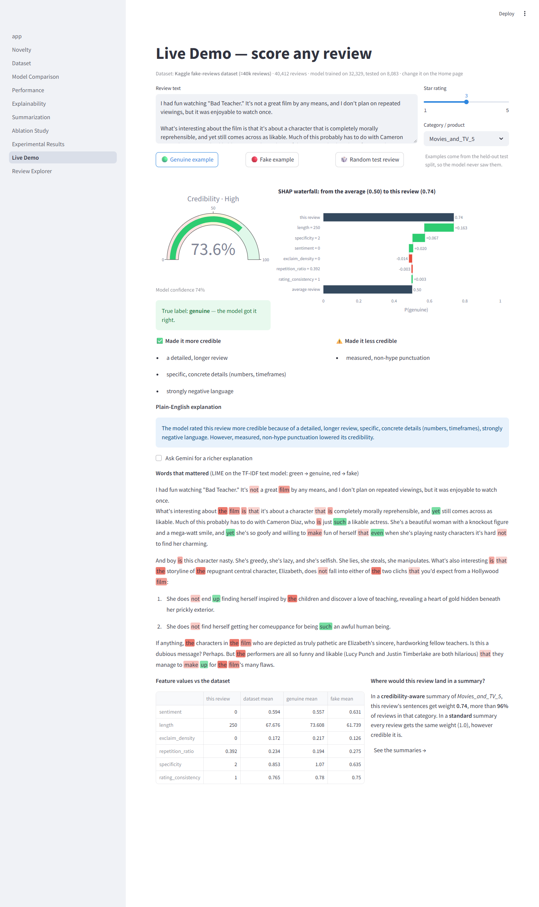
A held-out genuine review scored by the system: credibility gauge, SHAP waterfall showing how each
signal moved the score, the factors in plain English, the words that mattered (LIME), and how
much weight the review would get in a summary.

## S3. Live Demo: a fake review

A held-out computer-generated review. Repetitive wording pulls its credibility far below the
average, it falls under the low-credibility flags, and its summary weight is small.

## S4. Explainability: one review explained three ways
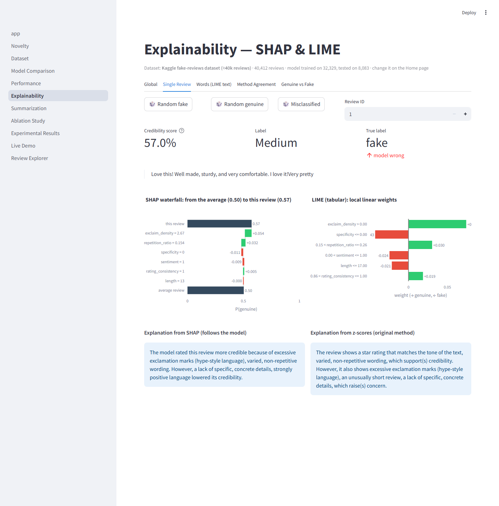
SHAP waterfall and LIME weights side by side, with the SHAP-based and original z-score
explanations for comparison.

## S5. Summarization: standard vs credibility-aware
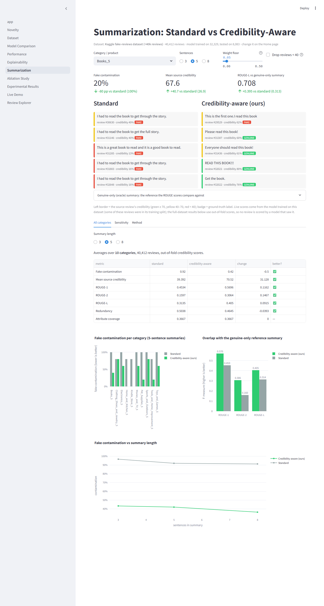
The same extractive summarizer with and without credibility weighting. Each sentence shows its
source review, credibility score and true label. Below that: the full-dataset evaluation (fake
contamination 92% → 42%, ROUGE-L 0.314 → 0.405).

## S6. Review Explorer
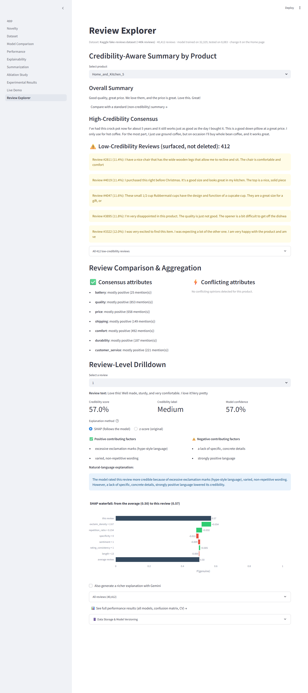
Product-level summary with low-credibility flags, attribute consensus/conflicts and a per-review drilldown.

## S7. Model Comparison
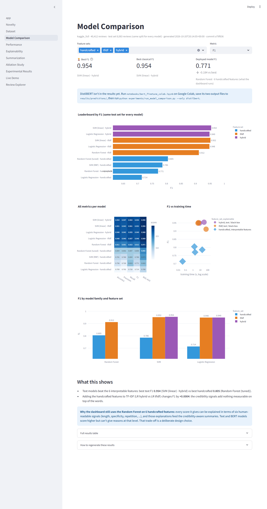

## S8. Performance Results
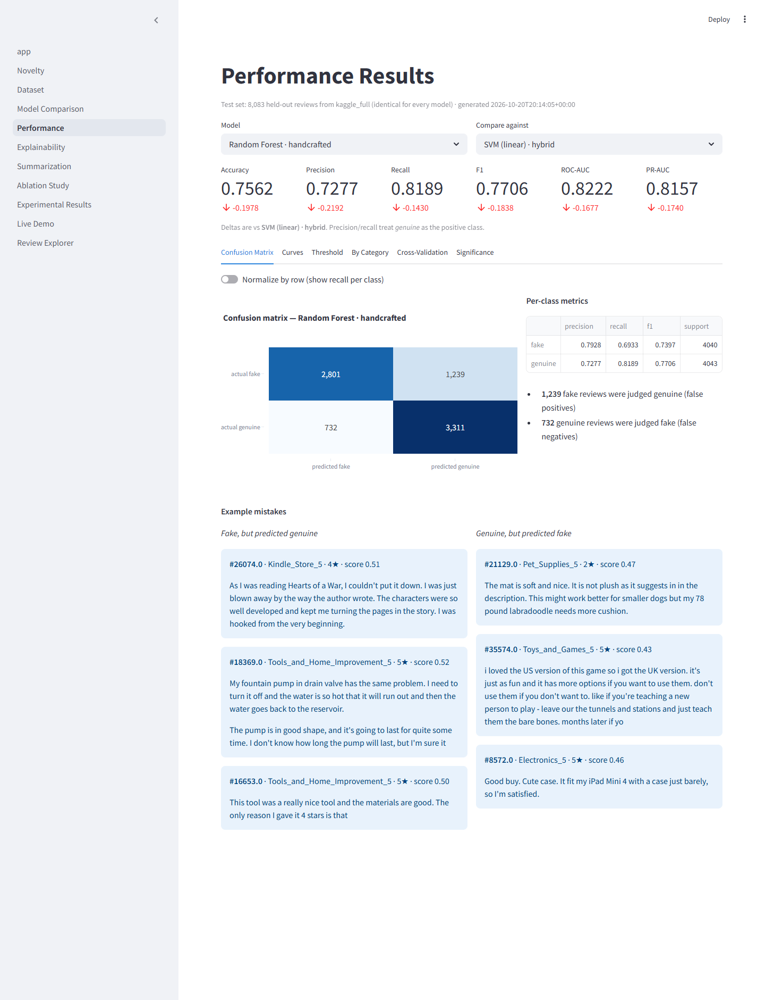

## S9. Ablation Study
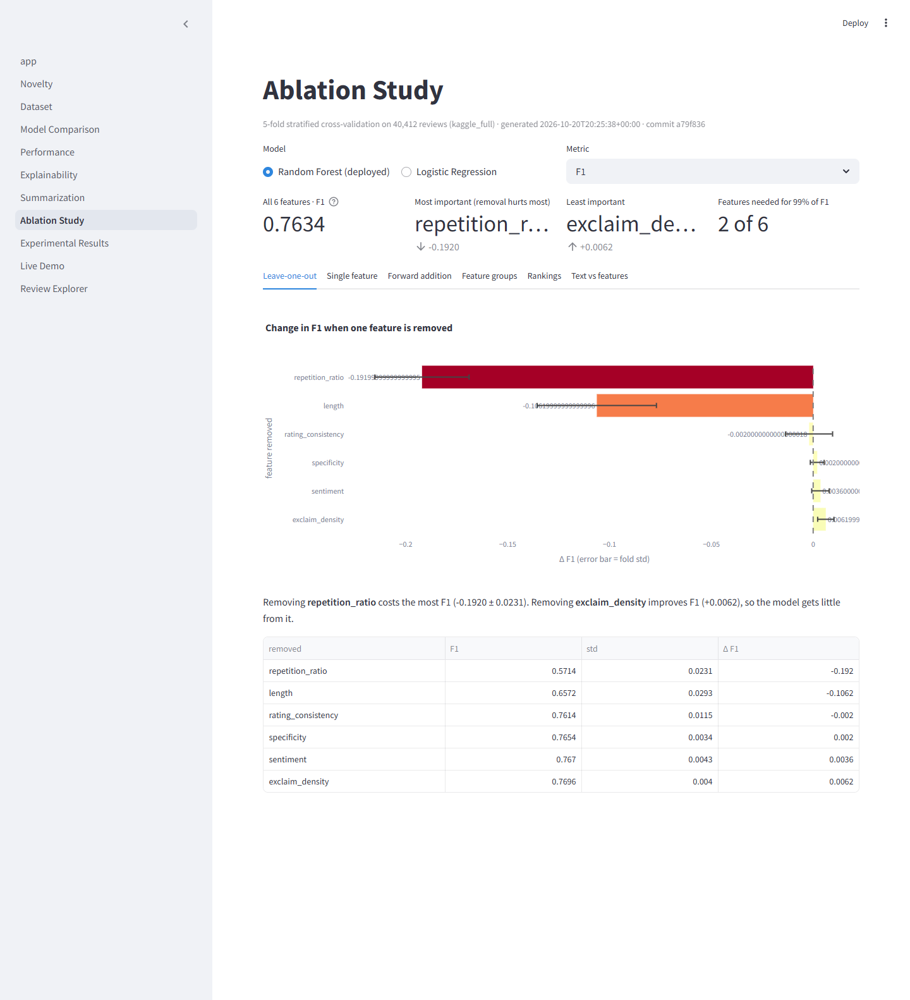

## S10. Experimental Results
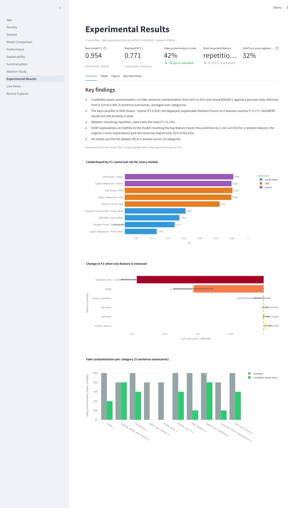

## S11. Dataset Explorer
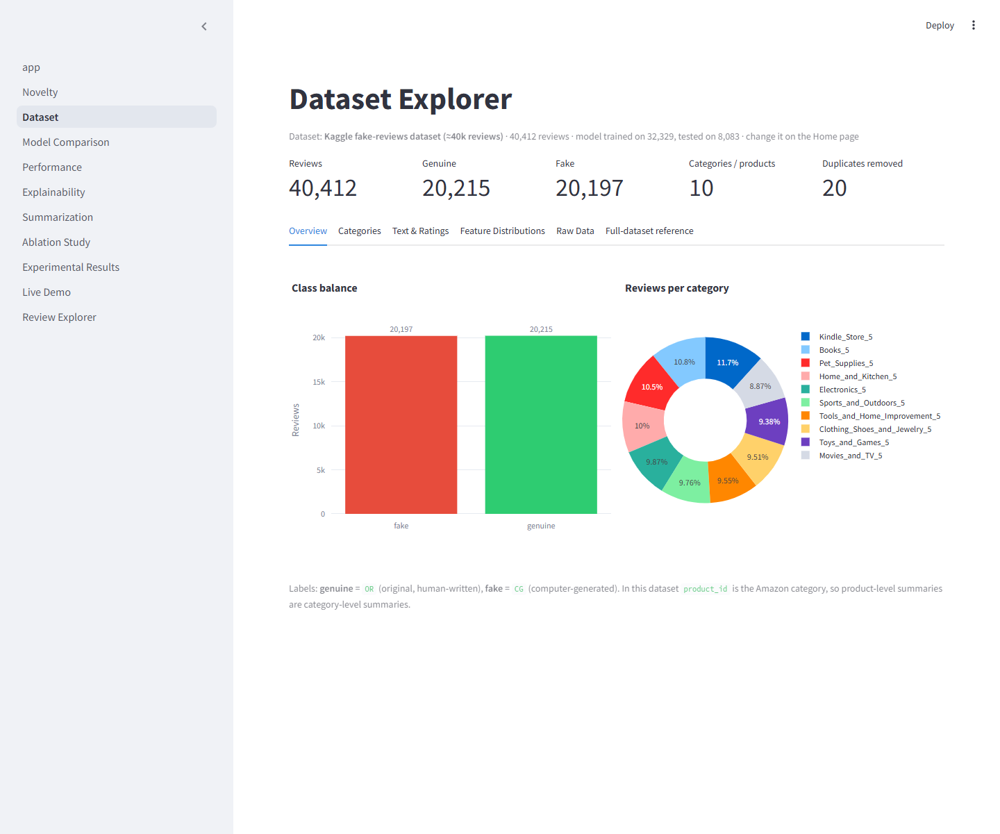

## S12. Novelty
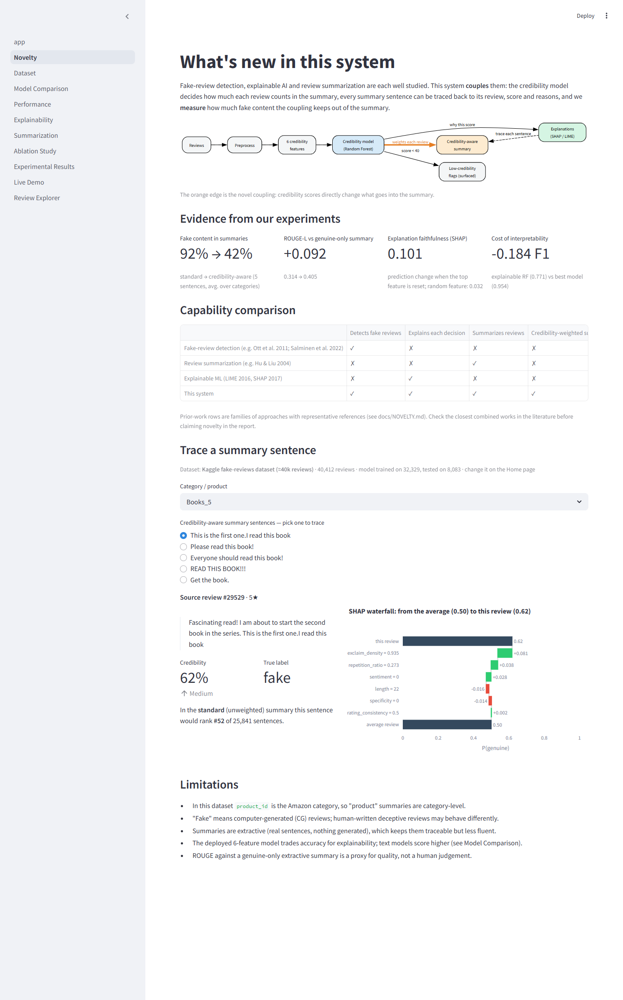
