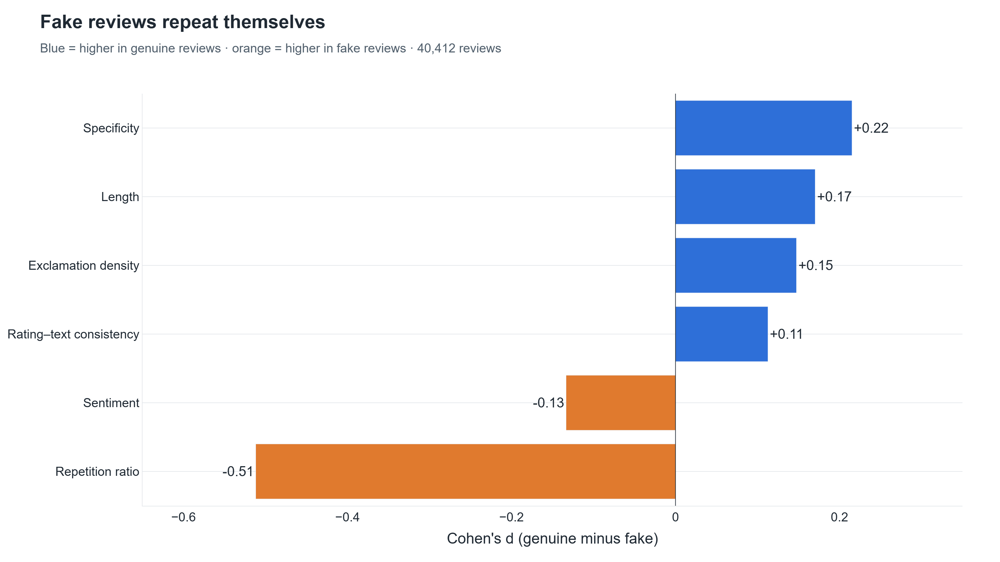

# 1. Full Dataset (≈40,000 reviews)

**Page:** Dataset · **Owner:** Member A

## What it is

The system is now tested on the complete Kaggle *Fake Reviews Dataset* instead of 15 hand-written
samples: **40,432 Amazon reviews** (40,412 after removing 20 exact duplicates) from **10 product
categories**, with a real label for every review: `OR` = original, human-written (**genuine**),
`CG` = computer-generated (**fake**). It is balanced: 20,215 genuine, 20,197 fake.

Every model and experiment uses the **same stratified 80/20 split** (32,329 train / 8,083 test),
so all comparisons are fair.

## Key finding

Fake reviews **repeat themselves**. Repetition ratio is the only signal with a medium-sized
difference between the classes (Cohen's d = −0.51). The others are small. Genuine reviews are
also slightly *longer* and, surprisingly, use slightly *more* exclamation marks.

## How to demo

1. **Home** → choose *Kaggle fake-reviews dataset (≈40k reviews)*. Point out "40,412 reviews".
2. **Dataset** page → the five numbers at the top (reviews, genuine, fake, categories, duplicates).
3. *Categories* tab → stacked bar: every category is balanced.
4. *Feature Distributions* tab → choose **repetition_ratio**: the fake distribution sits clearly to
   the right. Then choose **exclaim_density** to show the surprise.
5. *Raw Data* tab → filter Label = fake, Rating = 5 to show what generated reviews look like.

**Say:** "We moved from 15 samples to the full 40,000-review dataset with real labels, so every
number we show is a real benchmark, not a heuristic."

## Likely questions

- *Why is product = category?* The dataset has no product IDs, only categories, so "product
  summaries" are category summaries. Stated as a limitation.
- *Why remove duplicates?* Identical text posted twice is itself a spam pattern, and duplicates
  across the train/test split would leak.
