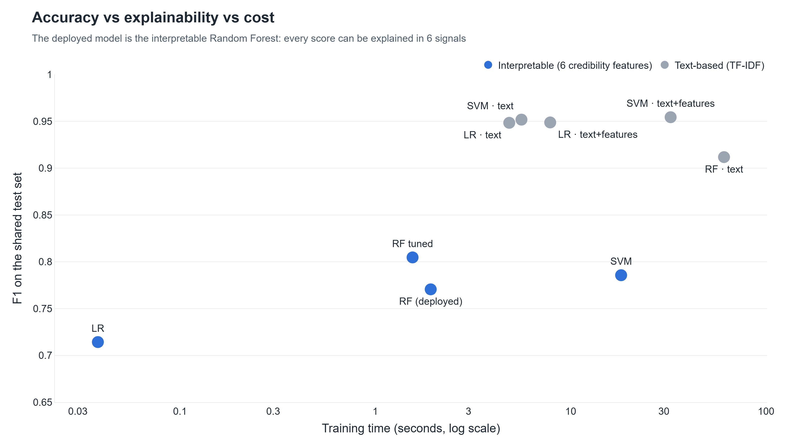

# 2. Model Comparison: Random Forest vs Logistic Regression vs SVM vs BERT

**Page:** Model Comparison · **Owner:** Member A

## What it is

Nine classical models trained and tested on exactly the same rows, on three kinds of input:

- **6 credibility features**: the interpretable signals the system explains (length, repetition, specificity, …)
- **TF-IDF text**: word and word-pair frequencies of the review
- **TF-IDF + features**: both together

DistilBERT is set up as a Google Colab notebook (`notebooks/bert_finetune_colab.ipynb`). Its
results are **pending a GPU run**; the page and tables add it automatically when the predictions file is added.

## Key results (5-fold cross-validation, F1)

| Model | Input | F1 (mean ± std) |
|---|---|---|
| SVM (linear) | TF-IDF + features | **0.951 ± 0.002** |
| SVM (linear) | TF-IDF text | 0.948 ± 0.001 |
| Logistic Regression | TF-IDF + features | 0.946 ± 0.001 |
| Logistic Regression | TF-IDF text | 0.944 ± 0.002 |
| Random Forest | TF-IDF text | 0.910 ± 0.002 |
| Random Forest (tuned) | 6 features | 0.803 ± 0.004 |
| SVM (RBF) | 6 features | 0.788 ± 0.005 |
| **Random Forest (deployed)** | 6 features | **0.763 ± 0.016** |
| Logistic Regression | 6 features | 0.718 ± 0.006 |

**The honest message:** text models classify better. The deployed Random Forest is kept because
every one of its scores can be explained in six human-readable signals, and those explanations
drive the summaries. Adding the six features to TF-IDF does not change accuracy significantly
(McNemar p = 0.84 for LR, 0.13 for SVM). Their value is **explainability, not extra accuracy**.

## How to demo

1. **Model Comparison** page → the three cards: best model, best classical, deployed model.
2. Leaderboard bar → "same 8,083 test reviews for every model".
3. Untick *tfidf* and *hybrid* in the filter → only the interpretable models remain.
4. Scatter plot → "top right is accurate but slow and unexplainable; our model is in the middle".
5. Read the blue box: *why the dashboard still uses the Random Forest*.

## Likely questions

- *Why not use the SVM then?* We could for detection, but it can't give per-review reasons a person
  can check. The trade-off is quantified, not hidden.
- *Where is BERT?* Notebook ready; needs a GPU (Colab, ~20 min). One command merges it in.
