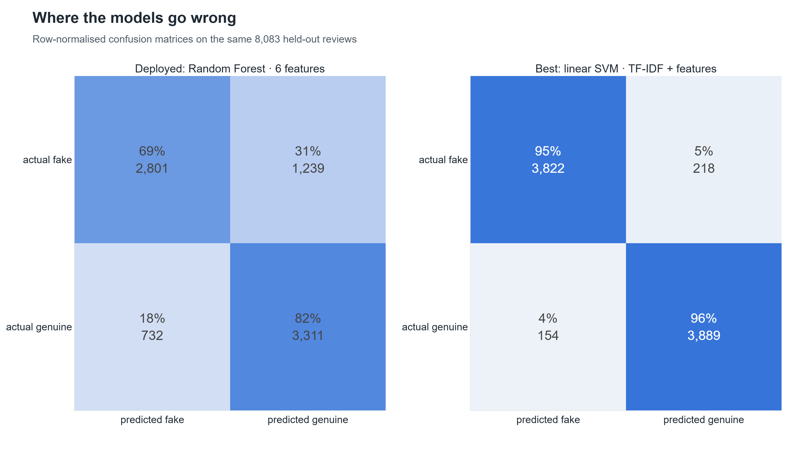

# 3. Performance Results: accuracy, precision, recall, F1, confusion matrix

**Page:** Performance · **Owner:** Member A

## What it is

Every model is evaluated on the same 8,083 held-out reviews with accuracy, precision, recall, F1,
ROC-AUC, PR-AUC and the confusion matrix, plus 5-fold cross-validation (mean ± std), per-category
breakdown, a decision-threshold explorer and McNemar significance tests between models.

## Key results

| | Accuracy | Precision | Recall | F1 | ROC-AUC |
|---|---|---|---|---|---|
| Deployed Random Forest (6 features) | 0.756 | 0.728 | 0.819 | 0.771 | 0.822 |
| Best: linear SVM (TF-IDF + features) | 0.954 | 0.947 | 0.962 | 0.954 | 0.990 |

(Single shared test split; precision and recall treat *genuine* as the positive class.)

**Reading the matrix:** the deployed model catches 82% of genuine reviews but lets **31% of fake
reviews through as genuine**. That is exactly why the summaries are still 42% contaminated, and
why a stronger credibility model would improve them further (future scope).

Of 36 model pairs, 33 differ significantly (McNemar, α = 0.05). The three that don't all compare
a text-only model with a text + features model (e.g. LR text vs LR text + features, p = 0.85).

## How to demo

1. **Performance** page, model = *Random Forest · handcrafted* → six metric cards.
2. *Compare against* = the best SVM → the cards show the deltas.
3. *Confusion Matrix* tab → toggle *Normalize by row*; scroll to the **example mistakes** (real
   reviews the model got wrong).
4. *Threshold* tab → drag the slider: precision and recall trade off live; dotted lines are the
   High (70) / Low (40) credibility cut-offs.
5. *Cross-Validation* tab → box plots show the results are stable across folds.
6. *Significance* tab → which differences are real.

## Likely questions

- *Why is recall higher than precision?* The model leans toward "genuine"; the threshold tab shows
  the trade-off if you want fewer fakes let through.
- *Is 0.77 F1 good?* It's modest, on purpose: six interpretable signals vs thousands of word features.
