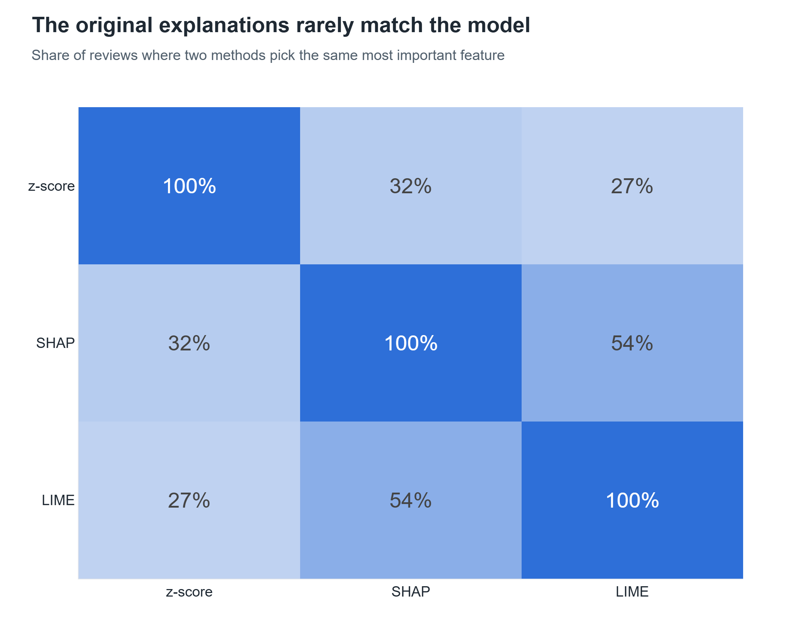

# 4. Explainability: SHAP and LIME

**Page:** Explainability (also Live Demo, Review Explorer) · **Owner:** Member B

## What it is

Three ways of explaining why a review got its credibility score:

| Method | How | Explains |
|---|---|---|
| z-score (original) | How unusual each feature value is vs the dataset average | — (doesn't look at the model) |
| **SHAP** | Exact contribution of each feature to *this* prediction (TreeExplainer) | the deployed Random Forest |
| **LIME** | A simple local model fitted around the review | the Random Forest (features) and the text model (**words**) |

The system's plain-English explanations now come from SHAP, so they say what the model actually did.

## Key results (500 held-out reviews)

**SHAP is the most faithful.** Resetting the feature each method calls most important moves the
prediction by **0.101** (SHAP), 0.094 (LIME), 0.062 (z-score), vs 0.032 for a random feature.

**The original explanations rarely matched the model:** z-score and SHAP pick the same top
feature for only **32%** of reviews. That's why we switched.

It also fixed a wrong assumption: the original rules treated exclamation marks as a fake signal,
but in this data genuine reviews use slightly more of them. SHAP follows the model instead of the rule.

## How to demo

1. **Explainability** page, *Global* tab → mean |SHAP| bar and the beeswarm: "repetition and length
   dominate".
2. *Single Review* tab → **🎲 Random fake** → SHAP waterfall (average 0.50 → this review) next to LIME,
   and the two explanation texts side by side.
3. **🎲 Misclassified** → "here's one the model got wrong, and the waterfall shows why".
4. *Words (LIME text)* tab → highlighted words; type your own sentence in the box.
5. *Method Agreement* tab → the heatmap and the deletion-test curve.

## Likely questions

- *Why three methods?* To check the explanations: methods that disagree tell you an explanation
  can't be taken on trust. We measured which one is faithful.
- *Are SHAP values exact?* Yes for tree models: base value + contributions = the predicted
  probability (tested in `tests/test_explainability.py`).
