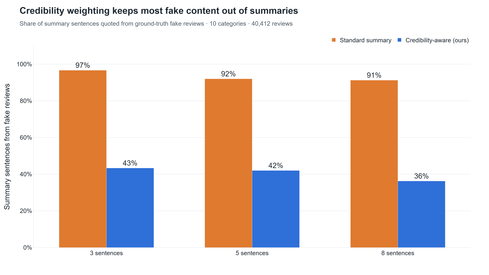
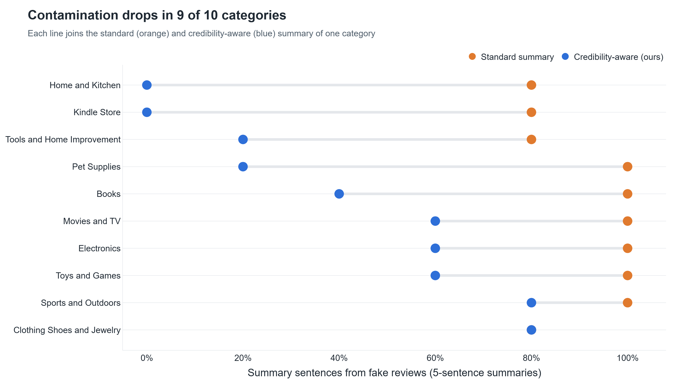
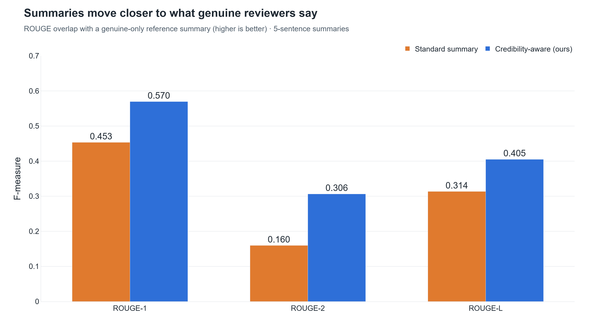
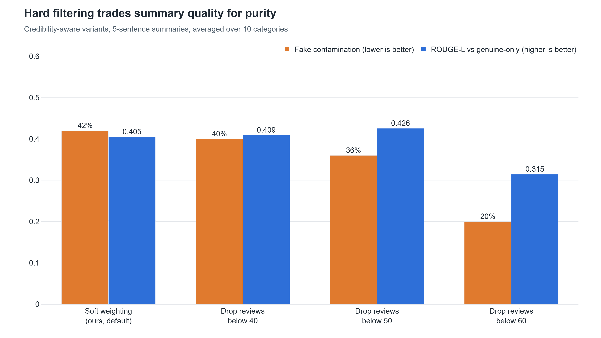

# 5. Summarization: standard vs credibility-aware (headline result)

**Page:** Summarization · **Owner:** Member B

## What it is

Three summaries per category from the **same** extractive summarizer (TF-IDF centroid ranking),
so the only difference is trust:

| Summary | Uses sentences from | Weight per sentence |
|---|---|---|
| Standard (baseline) | all reviews | 1 for everyone |
| **Credibility-aware (ours)** | all reviews | the review's credibility score |
| Genuine-only (reference) | ground-truth genuine reviews only | 1 |

Because the dataset has real labels, we can count how many summary sentences were quoted from
fake reviews (**fake contamination**). Credibility scores in the evaluation are **out-of-fold**:
no review is scored by a model that saw it.

## Key results (10 categories, 40,412 reviews)

| 5-sentence summaries | Standard | Credibility-aware | Change |
|---|---|---|---|
| Fake contamination | 92% | **42%** | −50 pp |
| ROUGE-L vs genuine-only | 0.314 | **0.405** | +0.091 |
| ROUGE-2 vs genuine-only | 0.160 | **0.306** | +0.147 |
| Mean credibility of quoted reviews | 39.4 | **70.5** | +31.1 |
| Redundancy | 0.504 | **0.465** | −0.039 |

Holds at every length: 3 sentences 97% → 43%, 8 sentences 91% → 36%.

**Why a normal summarizer is so contaminated:** computer-generated reviews use generic, typical
wording, which is exactly what a "pick the most central sentence" summarizer rewards.

**Trade-off:** dropping reviews below 60 cuts contamination to 20%, but ROUGE-L falls to 0.315
because genuine content is thrown away too. Soft weighting keeps the better balance.

## How to demo

1. **Summarization** page, category **Books_5**, 5 sentences.
2. Point at the three metric cards (contamination, source credibility, ROUGE-L, each vs standard).
3. Left column: count the red **FAKE** badges. Right column: mostly green **GENUINE**.
4. Switch to 8 sentences; tick *Drop reviews < 40* to show the hard filter.
5. *All categories* tab → the averages table (all ✅) and the per-category chart.

**Say:** "Same summarizer, same reviews. The only change is that we trust each review as much as
our model does, and fake content in the summary halves."

## Likely questions

- *Is ROUGE a fair measure?* It's a proxy: overlap with what a summary of only genuine reviews
  says. Contamination is the direct measure.
- *Why not delete low-credibility reviews?* They're surfaced separately as flags, so nothing is
  hidden from the user. Deleting also hurts quality (the trade-off chart).
