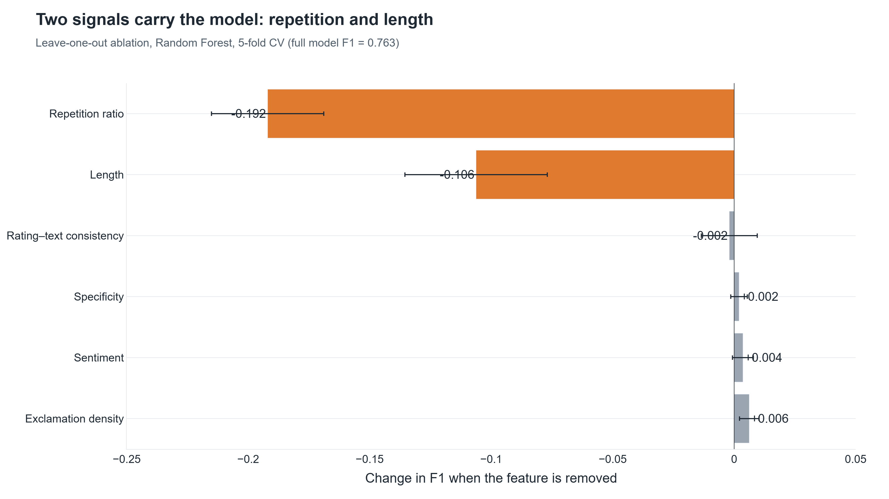
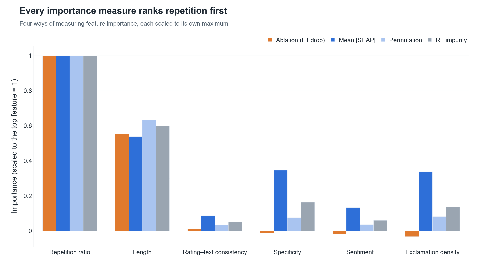

# 6. Ablation Study: which features matter?

**Page:** Ablation Study · **Owner:** Member A

## What it is

Retrain the model without each feature (and with each feature alone, adding them one by one, and
removing whole groups), always with 5-fold cross-validation, and measure the change in F1.
Repeated for the Random Forest and Logistic Regression.

## Key results (Random Forest, full model F1 = 0.763)

| Feature removed | ΔF1 |
|---|---|
| Repetition ratio | **−0.192** |
| Length | **−0.106** |
| Rating–text consistency | −0.002 |
| Specificity | +0.002 |
| Sentiment | +0.004 |
| Exclamation density | +0.006 |

- **Two signals carry the model:** repetition and length. Removing any of the other four changes
  F1 by less than 0.01, and removing three of them slightly *improves* it.
- All four importance measures (ablation, SHAP, permutation, RF impurity) put repetition first and
  length second; they disagree on the small ones (Spearman ρ = 0.6 between SHAP and ablation).

## How to demo

1. **Ablation Study** page → the four cards (full F1, most / least important, features needed).
2. *Leave-one-out* tab → the bar chart; the sentence under it is generated from the results.
3. *Forward addition* tab → "two features already reach most of the F1".
4. *Rankings* tab → the four methods side by side.
5. *Text vs features* tab → adding the features to TF-IDF isn't significant.

## Likely questions

- *Why keep the weak features?* They still make the explanations richer (SHAP gives them real
  weight for individual reviews), cost nothing, and future work can replace them with stronger signals.
- *Why does the Home chart differ?* RF impurity importance is biased toward features with many
  distinct values; the page warns about it.
