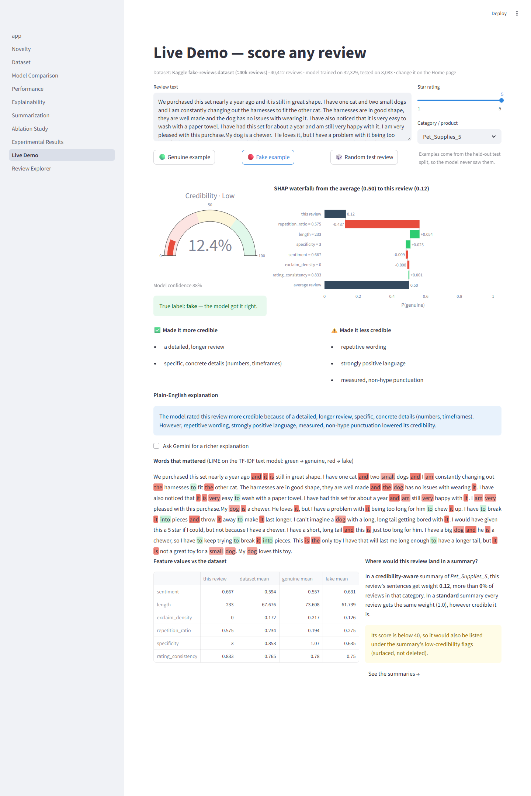

# 8. System Output: Live Demo and screenshots

**Page:** Live Demo · **Owner:** Member B

## What it is

A page where anyone can type a review (or load a held-out one) and watch the whole system work on it:

1. **Credibility score** (gauge) and model confidence
2. **SHAP waterfall**: how each signal moved the score from the average
3. Factors that made it more / less credible, and a **plain-English explanation**
4. **Words that mattered** (LIME on the text model)
5. Feature values vs the genuine and fake averages
6. **Where it lands in a summary**: its weight, and whether it'd be flagged as low-credibility
7. Optional Gemini explanation, grounded in the SHAP numbers

Examples come from the held-out test split, so the true label is shown next to the prediction.

All 12 dashboard screenshots are captured automatically (`python scripts/capture_screenshots.py`);
captions are in [SYSTEM_OUTPUT.md](../SYSTEM_OUTPUT.md). For the report's *System Output* section use
**S2** (genuine review), **S3** (fake review) and **S5** (summaries side by side).

## How to demo

See the step-by-step script in [demo-runbook.md](demo-runbook.md) (steps 2–5). Short version:

1. **🔴 Fake example** → low score, repetition is the big red bar, "model got it right".
2. **🟢 Genuine example** → high score, specific details push it up.
3. Type your own hype review → low score, explanation updates instantly.

**Tip:** examples are random, so click until you get a short one that reads well on the projector.
