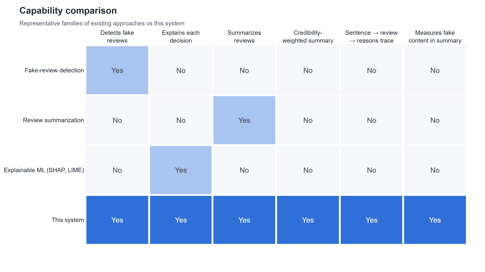

# 9. Novelty and comparison with existing systems

**Page:** Novelty · **Owner:** Member B · Full write-up: [NOVELTY.md](../NOVELTY.md)

## What's new

Fake-review detection, explainable ML and review summarization each exist on their own. This system
**couples** them:

1. **Credibility-gated summarization:** the credibility score decides how much each review counts in
   the summary; low-credibility reviews are surfaced, not deleted.
2. **End-to-end traceability:** every summary sentence → its review → its score → the SHAP reasons.
3. **Validated explanations:** three methods compared, the deployed one checked for faithfulness.
4. **A quantified trade-off:** how much accuracy the explainable model gives up (0.19 F1 vs the best
   text model), and proof the explainable features add no accuracy on top of text, only explanation.
5. **A contamination metric** for summaries: the share of sentences quoted from known-fake reviews.

## Comparison with existing systems

| | Detection systems | Review summarizers | XAI toolkits | **This system** |
|---|---|---|---|---|
| Output | fake / genuine label | summary | feature attributions | label + reasons + trusted summary |
| Trusts every review? | n/a | **yes** (92% fake content here) | n/a | **no** (42%) |
| Explains decisions | rarely | no | yes, generic | yes, per review, in plain English |
| Can a user check a summary sentence? | n/a | no | n/a | yes: traced to review, score, reasons |
| Evaluates fake content in output | no | no | no | yes |

**Before presenting:** check the closest combined works in the literature (see the search terms in
[NOVELTY.md](../NOVELTY.md)) and avoid saying "first" unless the search backs it up.

## How to demo

1. **Novelty** page → the pipeline diagram: "the orange arrow, credibility → summary, is the new part".
2. Evidence cards → four numbers, all live from the results.
3. *Trace a summary sentence* → pick a category and a sentence: review text, score, true label, SHAP
   waterfall, and where it would have ranked in a standard summary.
4. Scroll to *Limitations*: say them before anyone asks.
